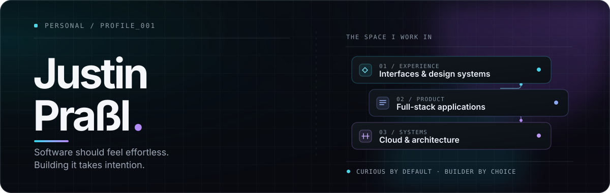
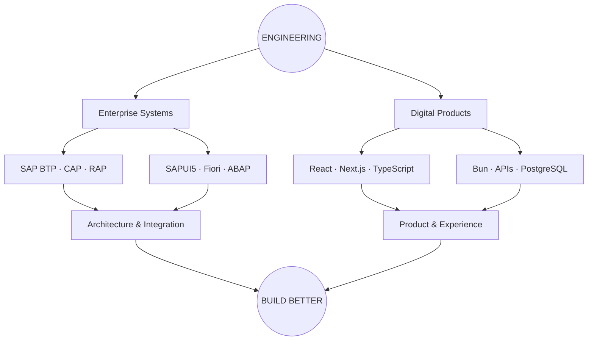

<div align="center">



<br/>

**I build the things you interact with. And the systems you don't see.**

Software Developer · Product Builder · UI Enthusiast

<br/>

<a href="https://justinprassl.de">Portfolio</a>
&nbsp;&nbsp; / &nbsp;&nbsp;
<a href="https://github.com/skitzcod4?tab=repositories">Repositories</a>
&nbsp;&nbsp; / &nbsp;&nbsp;
<a href="https://wrynnui.justinprassl.de">WrynnUI</a>

</div>

---

### `> booting developer profile...`

```text
╭──────────────────────────────────────────────────────╮
│                                                      │
│   JUSTIN.OS                             v2026.11     │
│   ──────────────────────────────────────────────     │
│                                                      │
│   USER       justinprassl                            │
│   LOCATION   Germany                                 │
│   ROLE       Software Developer                      │
│   MINDSET    Think. Design. Build. Improve.          │
│                                                      │
│   [●] Frontend Engineering                           │
│   [●] Backend & Cloud                                │
│   [●] Enterprise Software                            │
│   [●] UI / UX Design                                 │
│                                                      │
│   STATUS     Building something new...               │
│                                                      │
╰──────────────────────────────────────────────────────╯
```

I'm Justin. I work on enterprise software, build my own products and occasionally spend way too much time perfecting a tiny UI detail.

My world moves between **SAP ecosystems**, **modern full-stack development** and **designing digital experiences**.

I don't just want software to work. I want it to feel right.

---

### `~/workspace` — Currently running

These are some of the ideas taking shape outside my everyday work.

<details open>
<summary><b>WrynnUI — A design system with personality</b></summary>
<br/>

A React component library built around consistency, customization and thoughtful user experiences.

The idea: build a beautiful interface once, then bring that same quality to every application.

`React` · `TypeScript` · `Tailwind CSS` · `Bun`

**Focus:** Reusable components, themes, accessibility and developer experience.

</details>
<br/>

<sub>Projects are at different stages of development. Some are experiments, others are being built into larger products.</sub>

---

### `~/engineering` — Two worlds, one mindset

I enjoy working across different environments, from enterprise software to independent web products.



It's not about collecting technologies.

It's about understanding which tools solve the problem — and making sure everything works together.

---

### `~/toolbox` — My everyday environment

| Area | Technologies |
|---|---|
| **Frontend** | React, Next.js, TypeScript, Tailwind CSS |
| **Backend** | Bun, Node.js, Elysia, SAP CAP |
| **Enterprise** | SAP BTP, SAPUI5, Fiori, ABAP, RAP |
| **Data** | PostgreSQL, Drizzle, SAP HANA, PostGIS |
| **Infrastructure** | Docker, Linux, Cloud Foundry |
| **Creative** | UI/UX, Figma, Design Systems |

<details>
<summary><b>What else am I exploring?</b></summary>
<br/>

Swift development, game development with Unity, AI-assisted workflows, local LLMs and occasionally some technology that I absolutely did not need to experiment with at 2 AM.

</details>

---

### `~/process` — How I approach building

```text
    001         002         003         004
     │           │           │           │
     ▼           ▼           ▼           ▼

   THINK  ───  DESIGN ───  BUILD  ───  REFINE
     │           │           │           │
     │           │           │           │
  Understand   Make it     Make it     Make it
  the problem  intuitive   functional  better

                     ↖ REPEAT ↵
```

I believe great software comes from the combination of engineering discipline and attention to detail.

And yes, I will probably spend another hour adjusting that border radius.

---

### `~/terminal`

```bash
justin@github ~ % git status

On branch always-building

Changes not staged for commit:
  modified:   ideas/next-big-thing.md
  modified:   skills/architecture.md
  modified:   projects/wrynnui
  modified:   projects/side-projects

Untracked files:
  experiments/another-idea-at-midnight

justin@github ~ % _
```

<details>
<summary>💡 <b>One more thing...</b></summary>
<br/>

I have a habit of turning small ideas into unnecessarily ambitious projects.

A simple UI component becomes a design system.

A small application becomes a platform.

And a quick experiment somehow ends up requiring three Docker containers and a database.

**But that's part of the fun.**

</details>

---

<div align="center">

**Good software is engineered. Great experiences are designed.**

<br/>

<sub>Built with curiosity, caffeine and probably too many open VS Code tabs.</sub>

<br/><br/>

`// end of README — beginning of something else`

</div>
